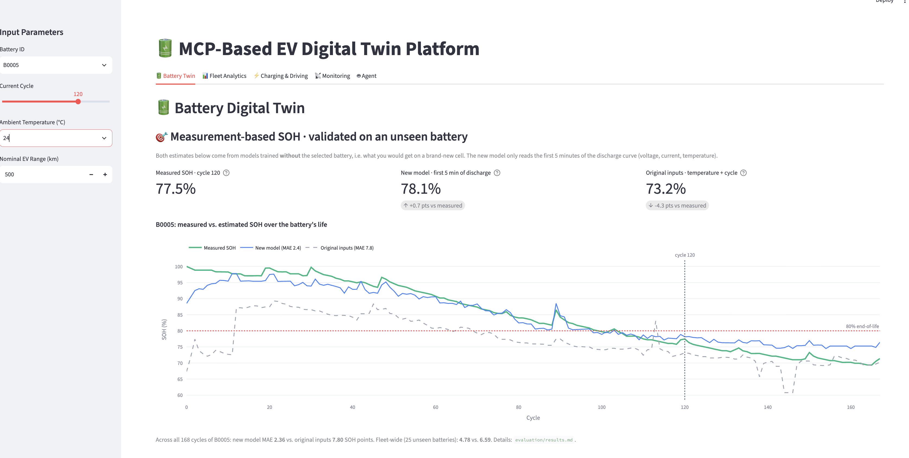
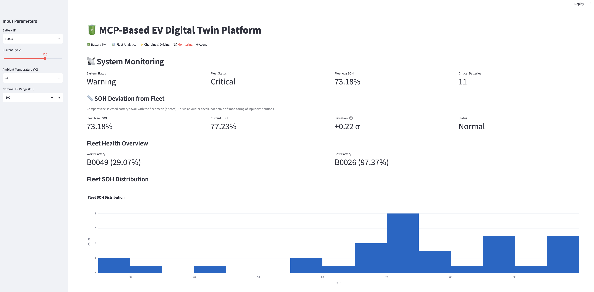
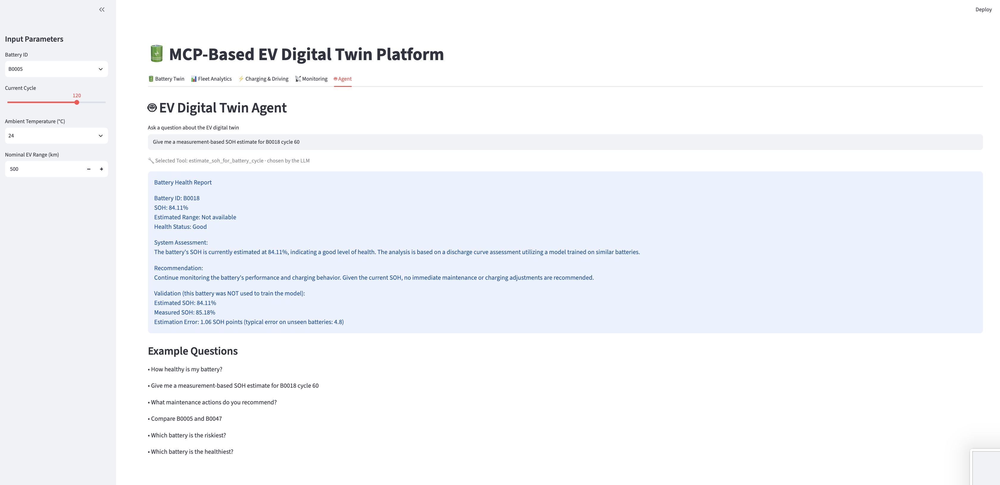

# 🔋 MCP-Based EV Digital Twin Agent

[](https://github.com/mahmutcanborann/mcp-ev-digital-twin-agent/actions/workflows/tests.yml)


---

## 👨‍💻 Author

# **Mahmut Can Boran**

**AI Engineer | Automotive Software Enthusiast | Computer Engineer**

Passionate about Agentic AI, Model Context Protocol (MCP), Large Language Models, Digital Twins, and Intelligent Automotive Software Systems.

---

## 🚀 Overview

An AI-powered **EV Digital Twin** platform that combines **battery health prediction, fleet analytics, intelligent tool orchestration through the Model Context Protocol (MCP), and LLM-powered reasoning** to monitor, analyze, and explain electric vehicle battery behavior.

Unlike a traditional dashboard, this project dynamically discovers available MCP tools, selects the most appropriate tool using an LLM, executes engineering analyses, injects fleet-aware context, and generates structured battery health reports through multi-step reasoning.

---

# 🚀 Features

## 🔋 Battery Digital Twin

- Battery State of Health (SOH) Prediction
- Remaining Useful Life (RUL) Estimation
- Estimated Driving Range Prediction
- Battery Health Classification
- Digital Twin Timeline Visualization
- What-if Scenario Simulation

---

## 🚗 Fleet Intelligence

- Fleet-wide Battery Comparison
- Fleet Health Ranking
- Fleet Anomaly Detection (Isolation Forest)
- Battery Outlier Identification
- SOH Deviation Check vs. Fleet (z-score)

---

## 🤖 Agentic AI

- Model Context Protocol (MCP) Integration
- Dynamic MCP Tool Discovery
- Automatic Tool Selection with Gemma
- Multi-Step Reasoning
- Fleet-aware Context Injection
- Robust tool selection: retry, schema-checked arguments, keyword fallback when the LLM is unavailable
- Engineering Report Generation
- Intelligent Tool Orchestration

---

## 📚 Battery Knowledge Base

The agent combines numerical battery predictions with engineering knowledge to explain:

- Battery degradation
- State of Health (SOH) interpretation
- Charging recommendations
- Battery maintenance suggestions
- Risk assessment
- Engineering-oriented battery reports

---

## ⚙️ Deployment

- Streamlit Dashboard
- Dockerized Deployment
- Hugging Face Spaces

---

# 🏗️ System Architecture

```text
                     User Question
                           │
                           ▼
               Discovery MCP Agent
                           │
                           ▼
                Dynamic Tool Discovery
                           │
                           ▼
              Gemma Tool Selection
                           │
                           ▼
                    MCP Tool Server
                           │
      ┌──────────────┬──────────────┬──────────────┐
      ▼              ▼              ▼
 Battery Twin   Fleet Analytics   Driving Analytics
      │              │              │
      └──────────────┴──────────────┘
                     ▼
             Engineering Reasoning
                     ▼
           Battery Health Report
```

---

# ▶️ Running

**Local**

```bash
python -m venv .venv && source .venv/bin/activate
pip install -r requirements.txt
streamlit run dashboard/app.py          # dashboard on http://localhost:8501
ollama pull gemma3:4b                   # optional (Ollama running): LLM explanations in the Agent tab
pytest tests/                           # tests (LLM test is skipped without Ollama)
```

**Docker**

```bash
docker compose up --build
```

Ollama is not part of the container; it is expected on the host (`OLLAMA_URL=http://host.docker.internal:11434/api/generate`). Without it the dashboard still works: the agent falls back to keyword-based tool selection and shows the raw tool result with a notice instead of an LLM explanation.

---

# 📊 Current Capabilities

| Module | Status |
|----------|:------:|
| Measurement-based SOH Estimation (validated on unseen batteries) | ✅ |
| Battery SOH Prediction (per-battery curve, legacy) | ✅ |
| Remaining Useful Life (RUL) | ✅ |
| Driving Range Estimation | ✅ |
| Battery Digital Twin | ✅ |
| Digital Twin Timeline | ✅ |
| What-if Scenario Simulation | ✅ |
| Fleet Analytics | ✅ |
| Fleet Anomaly Detection | ✅ |
| SOH Deviation Check (fleet z-score) | ✅ |
| MCP Tool Calling | ✅ |
| Dynamic Tool Discovery | ✅ |
| Multi-Step Reasoning | ✅ |
| Battery Knowledge Base | ✅ |
| Docker Deployment | ✅ |
| Hugging Face Deployment | ✅ |

---

# 📏 Model Evaluation: does it work on a battery it has never seen?

The first SOH model reached **R² 0.93** on a random train/test split. That number is misleading: cycles of the same battery end up in both train and test, and the model gets the battery ID as an input, so it mostly memorises each battery's curve. The honest test is **leave-one-battery-out (LOBO)**: train on all batteries except one, test on the held-out battery, repeat for every battery.

Under LOBO, the original inputs (temperature + cycle number) only reach R² 0.34. A new model estimates SOH from **measurements in the first 5 minutes of a discharge** (terminal voltage at 60 s and 300 s, discharge current, start temperature). The full discharge time is deliberately *not* used: at constant current it equals the capacity, i.e. the label itself.

NASA PCoE battery dataset, 25 batteries with ≥ 40 cycles (2,353 discharge cycles):

| Evaluation | Inputs | MAE (SOH pts) | RMSE (SOH pts) | R² |
|---|---|:---:|:---:|:---:|
| Random 80/20 row split | battery ID, temperature, cycle | 1.23 | 3.83 | 0.926 |
| **Leave-one-battery-out** | temperature + cycle (original model) | 6.59 | 9.70 | 0.342 |
| **Leave-one-battery-out** | charge window 3.9–4.2 V + CV time | 6.16 | 9.31 | 0.393 |
| **Leave-one-battery-out** | **first 5 min of discharge (new model)** | **4.78** | **6.61** | **0.694** |
| **Leave-one-battery-out** | charge + first 5 min of discharge | 5.28 | 7.66 | 0.590 |

- On the reference cells B0005 / B0018 the held-out error is **2.4 / 2.8 SOH points**; on the noisiest cells (B0045, B0054) it rises to 9–10 points.
- Including the 9 short, noisy batteries (< 40 cycles), the discharge-only model does not beat the baseline (MAE 7.65 vs 7.87); combining charge and discharge features works best there (MAE 6.61, R² 0.44). Full tables: [`evaluation/results.md`](evaluation/results.md).
- Charge features help less than expected, probably because charge protocols differ between NASA test groups.

### MCP tools for the new model

| Tool | What it does |
|---|---|
| `estimate_soh_for_battery_cycle(battery_id, cycle)` | Estimates SOH of a recorded test cycle with a model trained **without** that battery and returns the measured SOH next to it, so the error is visible. |
| `estimate_soh_from_measurements(voltage_at_60s, voltage_at_300s, mean_discharge_current, start_temperature, ambient_temperature)` | Estimates SOH of any cell from five numbers, no battery ID needed. |

Example: *"Give me a measurement-based SOH estimate for B0018 cycle 60"* → estimated 84.1 %, measured 85.2 %.

### Reproduce

```bash
# 1. Download the Kaggle "NASA Battery Dataset" (cleaned_dataset) and copy
#    metadata.csv -> data/metadata.csv and data/ -> data/data/   (~650 MB, git-ignored)
python evaluation/build_dataset.py   # -> data/features/soh_dataset.csv (in git)
python evaluation/evaluate_soh.py    # -> evaluation/results.md, results.json
pytest tests/
```

`data/features/soh_dataset.csv` is committed, so steps 2–3 run without the raw data.

# 🧪 Early cycle life prediction (Severson et al. 2019)

A second, separate experiment on the 124 LFP/graphite cells (A123 APR18650M1A, fast charging) from Severson et al., *Nature Energy* 2019 ([data.matr.io/1](https://data.matr.io/1/)). The task is **early cycle life prediction**: predict a cell's total cycle life (cycles to 80% of nominal capacity, 148 to 2,237 here) from its **first 100 cycles**, before capacity fade is visible. This is not classic RUL.

This dataset is **never merged with the NASA data**: different chemistry, test protocol, model and evaluation.

**Method (follows the paper):** the 20 candidate features of the paper's Table 1, mainly the change in the discharge curve between cycle 10 and 100, ΔQ<sub>100-10</sub>(V) (log variance, minimum, skewness, kurtosis), plus capacity fade, charge time, temperature and internal resistance. Target log10(cycle life), elastic net tuned by repeated 4-fold CV on the training cells only. Same split as the paper: 41 train / 43 primary test / 40 secondary test (batch 3, collected after the paper's model development).

Mean absolute percent error on cells the model never saw ([full results](evaluation/cycle_life_results.md)):

| Model | Primary test (w/o outlier) | Secondary test | All 82 test cells | Paper |
|---|---|---|---|---|
| Baseline: training mean | 28.2% | 36.1% | 32.0% | - |
| Variance model (1 feature) | 13.2% | 11.4% | 12.3% | 13.2% / 11.4% |
| **Discharge model (6 features)** | **9.5%** | **10.0%** | **9.7%** | 10.1% / 8.6% |
| Full model (9 features) | 9.2% | 12.7% | 10.9% | 7.5% / 10.7% (= 9.1% headline) |

- The single-feature variance model reproduces the paper almost exactly (log var ΔQ vs. log cycle life: ρ = -0.93, as in the paper), which validates the data pipeline.
- Best result: **9.7% error vs. the paper's 9.1%**, from the discharge model. Our full model is weaker than the paper's, most likely because the summary data has no in-cycle temperature series, so the "temperature integral" feature is only approximated, and the paper also dropped four cells with faulty temperature probes.
- With 41 training cells, a random forest on all features (11.9%) does worse than the linear elastic net: a small-data problem where a simple, well-chosen feature beats model complexity.
- The outlier (b2c1, 148 cycles) is reported both with and without, as in the paper.

```bash
python evaluation/build_severson_dataset.py --raw data/severson/raw --out data/severson/processed  # raw .mat files needed
python evaluation/build_cycle_life_features.py   # -> data/severson/processed/features.csv (in git)
python evaluation/evaluate_cycle_life.py         # -> evaluation/cycle_life_results.md / .json
```

---

# 🛠️ Tech Stack

## AI / Machine Learning

- Scikit-learn
- Random Forest
- Isolation Forest
- Gemma LLM
- Ollama

### Agent Framework

- Model Context Protocol (MCP)
- FastMCP
- Dynamic Tool Discovery
- Agentic AI

### Backend

- Python
- Pandas
- NumPy
- Joblib

### Frontend

- Streamlit
- Plotly

### Deployment

- Docker
- Hugging Face Spaces

---

# 📸 Demo

## Measurement-based SOH on an unseen battery



Both models are trained without B0005. Over its 168 cycles the new model is off by 2.4 SOH points on average, the original inputs by 7.8.

---

## Monitoring and SOH deviation



System and fleet status, the selected battery's deviation from the fleet mean (z-score) and the fleet SOH distribution.

---

## Agentic AI Assistant



The LLM picks the MCP tool; the validation block (estimated vs. measured SOH) is added from the tool result in code, so its numbers are exact.

---

# ⚠️ Known Limitations

Being explicit about what the system does *not* do yet:

- **Legacy `predict_soh` / `estimate_rul`** take a battery ID and cycle number as input. They reproduce the degradation curve of a battery the model has already seen and cannot handle a new battery. Use `estimate_soh_for_battery_cycle` / `estimate_soh_from_measurements` for measurement-based estimates.
- **RUL** is still computed from the legacy curve model. Random Forests do not extrapolate beyond the cycles seen in training, so long-horizon RUL is unreliable. The dashboard and the `estimate_rul` tool therefore report a status (`estimated`, `already_below_threshold`, `not_projected`) instead of an ambiguous `0` / `-1`. A forecasting model on top of the measurement-based SOH estimate is the next step.
- **Fresh batteries are underestimated:** in the first ~10 cycles of a held-out battery, the measurement-based model reads SOH 5–10 points too low.
- **What-if scenarios** use heuristic degradation rates (0.02 / 0.04 / 0.08 SOH-% per cycle), not values fitted from data; the dashboard says so next to the charts.
- **SOH deviation check, not drift detection:** `check_soh_deviation` compares one SOH value with the fleet mean (z-score outlier check). Real data-drift monitoring would compare input distributions between training and production data over time; with 34 lab cells and no production stream there is nothing meaningful to monitor yet.
- **Knowledge base** injects the whole markdown file when a keyword matches; there is no retrieval / ranking yet (RAG is on the roadmap).
- **Data sources are not linked to one vehicle:** battery data (NASA lab cells), driving telemetry and charging sessions come from three independent public datasets.
- The "fleet" is the 34 NASA test cells, not vehicles.

---

# 🔮 Roadmap

- RUL forecasting on top of the measurement-based SOH estimate
- Native LLM tool calling instead of rule-based tool selection
- Multi-Agent EV Architecture
- Vector Database Integration
- Retrieval-Augmented Generation (RAG)
- Real-Time Vehicle Telemetry Integration
- Predictive Maintenance Scheduling
- Fleet Decision Support System

---

# ⭐ Why this project?

This project demonstrates how **Model Context Protocol (MCP)**, **Agentic AI**, **LLMs**, and **predictive battery analytics** can be combined to build an intelligent EV Digital Twin capable of autonomous tool discovery, engineering reasoning, and fleet-level battery monitoring.

The project was designed to explore modern AI agent architectures while addressing real-world battery monitoring challenges in electric vehicles.

---

# 📬 Contact

**Mahmut Can Boran**

- 💼 LinkedIn: https://www.linkedin.com/in/mahmutcanboran/
- 💻 GitHub: https://github.com/mahmutcanborann

If you're interested in **Agentic AI, MCP, Digital Twins, Battery Analytics, or Automotive Software Engineering**, feel free to connect or reach out.